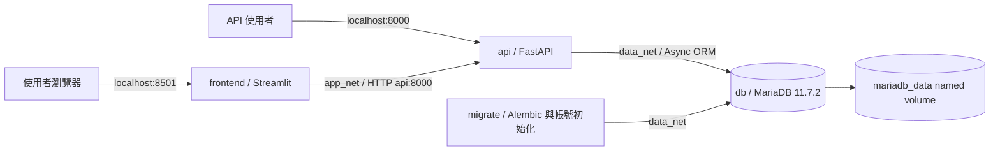

# 系統架構

本文件描述目前程式與 `compose.yaml` 的實際架構。系統透過 Streamlit 提供互動介面，以 FastAPI 處理認證與資料查詢，MariaDB 保存應用資料。

## 容器與網路

| 服務 | 職責 | 生命週期 |
| --- | --- | --- |
| db | MariaDB 11.7.2、InnoDB、utf8mb4 資料儲存 | 常駐，健康檢查確認連線與 InnoDB 初始化 |
| migrate | Alembic schema 升版、選用的測試帳號建立與密碼同步 | 一次性，成功後結束碼為 0 |
| api | FastAPI、Pydantic、JWT、角色授權、Async ORM | 常駐，提供 REST 與 Swagger |
| frontend | Streamlit 多頁面、登入／登出、服務概況與管理員清單 | 常駐，透過 HTTPX 呼叫 API |

所有服務由單一 `compose.yaml` 管理，不分環境檔。`app_net` 連接 frontend 與 api；`data_net` 為 internal 網路，連接 db、migrate 與 api。前端不直接連資料庫。

API 與 Streamlit 預設只對主機 `127.0.0.1` 公開 8000、8501，MariaDB 不對主機公開 3306。容器間使用服務名稱，例如 `api:8000`、`db:3306`，主機的連接埠調整不會改變這些內部位址。

## 啟動與映像

Compose 使用 `depends_on` 的健康與成功完成條件控制啟動相依。migrate 失敗時，依賴它的 API 不會啟動。healthcheck 只回報狀態，不會自行重啟仍存活的 unhealthy 程序。

後端與前端均採 Python 3.12 多階段 Dockerfile：builder 準備 wheels，runtime 安裝套件並以非 root 帳號執行。api 與 migrate 共用後端映像，分別使用 HTTP server 與初始化指令。

## 資料存取與持久化

所有應用資料讀寫都經 SQLAlchemy Async ORM 與 asyncmy。每次工作使用獨立 AsyncSession，交易結束後歸還連線；SQLAlchemy Engine 設定 pool_size=5、max_overflow=5、pool_pre_ping、1800 秒回收及 30 秒等待上限。Alembic operations 管理 schema，不在 API 啟動時自動 create_all。

ORM 模型包含 User、Category、Record、ImportBatch 與 AuditLog，分別管理帳號、分類、資料記錄、匯入冪等批次及操作稽核。Record 使用固定精度數值、UTC 時間、建立者與版本欄位；寫入與稽核同一交易提交。應用資料庫連線帳號由 `.env` 設定，與應用登入帳號屬不同層級。

MariaDB `/var/lib/mysql` 掛載至 Compose named volume，預設名稱為 `data-monitor-platform_mariadb_data`。一般 `down` 與容器重建會保留資料，`down -v` 會刪除資料。Volume 不是備份；正式部署仍需另建備份及還原程序。

## 認證與權限

Streamlit 將登入資料交給 `POST /api/v1/auth/tokens`，FastAPI 驗證資料庫密碼雜湊後發出有效期 15 分鐘的 HS256 JWT。後續請求使用 Bearer token，後端驗證簽章、期限、issuer、audience，並重新確認帳號存在且啟用。

- 公開註冊固定建立 user，不能指定角色。
- admin 可管理全部資料、建立分類及查看使用者清單。
- user 可建立及匯入資料，只能修改／刪除自己的記錄。
- viewer 僅可讀取共享資料與自身資訊，無寫入或管理權限。
- Streamlit 以 Session State 保存登入狀態，登出只清除前端 session。

`SEED_DEMO_USERS=true` 時，migrate 會建立缺少的 admin／viewer，並依 `DEMO_ADMIN_PASSWORD`、`DEMO_VIEWER_PASSWORD` 同步既有密碼。僅密碼不同才更新雜湊，保留 id、角色及啟用狀態；兩組密碼都須至少 12 個字元。seed 關閉時不進行上述操作。

## 功能與部署限制

目前可使用註冊登入、使用者查詢、三角色授權、分類建立、資料 CRUD、分頁篩選排序及 CSV／JSON 預檢匯入。角色異動介面屬系統管理範圍，目前尚未提供；資料依共享空間規則讀取。尚未提供即時資料接收、Redis、批次 worker、WebSocket 推送、統計分析、Excel、即時圖表與告警。

目前沒有 refresh token 或後端登出撤銷，密碼變更前已發出的 JWT 仍可使用至原到期時間。登入／註冊限流使用單程序 IP 記憶體視窗，重啟會清除，Streamlit 代理下多名使用者共用同一來源額度。DB runtime 與 migration 尚共用帳號，對外部署前需拆分權限、使用非範本憑證、加入 TLS，並確認指定的 MariaDB 11.7 rolling release 維護策略。

## 官方參考

- [FastAPI Docker 部署](https://fastapi.tiangolo.com/deployment/docker/)
- [Streamlit Docker 部署](https://docs.streamlit.io/deploy/tutorials/docker)
- [Docker Compose 啟動相依](https://docs.docker.com/compose/how-tos/startup-order/)
- [SQLAlchemy asyncmy dialect](https://docs.sqlalchemy.org/en/20/dialects/mysql.html#asyncmy)
- [MariaDB 版本與維護政策](https://mariadb.org/about/)
