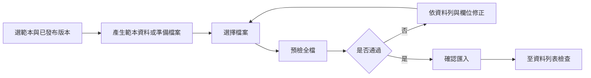

# Streamlit 前端操作手冊

## 1. 登入與頁面

依 README 啟動後，開啟 [Streamlit](http://localhost:8501)。若調整 STREAMLIT_PORT，請改用對應連接埠。

在「登入」輸入帳密；沒有帳號時可至「註冊」建立 User。密碼至少 12 字元，帳號為 3–64 個英數或底線。登入後側邊欄顯示目前角色，按「登出」清除目前登入狀態；JWT 到期需重新登入。

| 頁面 | 適用角色 | 用途 |
| --- | --- | --- |
| 服務概況、資料列表 | 全部 | 查看服務及共享資料 |
| 建立資料、批次匯入 | Admin、User | 建立單筆或批次資料 |
| 匯入 Schema 範本 | 全部 | Admin／User 管理可編輯範本；Viewer 僅檢視共享規則 |
| 使用者清單、分類管理 | Admin | 查看使用者、建立分類 |

User 只能修改／刪除自己的資料，Admin 可管理全部，Viewer 不可寫入。可見頁面不取代後端權限檢查。

## 2. 單筆資料操作

「建立資料」輸入標題、數值、分類及含時區的 ISO 8601 時間後按「建立資料」。例如 `2026-10-28T10:00:00+08:00`，後端以 UTC 儲存。

「資料列表」可設定分類、建立者、來源、時間區間、排序與頁碼；時間範圍含起點、不含終點。選取「本頁可管理資料」後可儲存變更，或勾選確認再永久刪除。遇到 409 表示資料版本或交易衝突，請重新讀取後操作。

## 3. 建立可重複使用的匯入 Schema

Schema 是匯入檔案的欄位對應及驗證規則，保存在 MariaDB。它不會替正式資料表新增欄位，最終仍寫入以下四個必填欄位：

| 目標欄位 | 必要規則 |
| --- | --- |
| title | 非空標題，最多 200 字元 |
| value | 有限數值，最多 12 位整數與 6 位小數 |
| category_id | 已存在的分類 ID，不是分類名稱 |
| timestamp | 可解析且含時區的時間，轉 UTC 保存 |

### 步驟一：設定新範本

1. 開啟「匯入 Schema 範本」，選擇「建立範本」。
2. 輸入「範本名稱」與選填說明。User 只能建立 private，Admin 可建立 private 或 shared。
3. 選擇 CSV 或 JSON；同一版本只對應一種檔案格式。
4. 設定「額外欄位策略」：reject 拒絕未定義欄位，ignore 接受但不儲存，預檢會列出忽略的欄位。
5. 選擇是否去除來源資料值的首尾空白。此設定只影響來源驗證前的處理，不取消正式資料欄位自身的正規化及限制。
6. 對四個目標欄位各設定一個來源欄名。來源名稱可為中文，須與檔案完全一致且區分大小寫，四個來源不可重複。

例如來源檔案使用以下欄位：

| 來源欄名 | 目標欄位 | 可選 data_type |
| --- | --- | --- |
| 名稱 | title | 未指定或 string |
| 量測值 | value | 未指定、integer 或 decimal |
| 分類編號 | category_id | 未指定或 integer |
| 量測時間 | timestamp | 未指定或 datetime |

也可以勾選「從既有版本複製規則」，選取範本與版本，改名保存為新的範本。User 可用此方式將共享規則複製為自己的 private 範本。

### 步驟二：選擇是否限制型別

data_type **可留為「未指定」**，每個欄位各自決定。未指定時不增加來源型別檢查，但仍須通過上述正式欄位規則，不能缺欄位、使用 null 或寫入非法值。

| 指定型別 | 檢查方式 |
| --- | --- |
| string | JSON 必須原本就是字串；不將數字自動轉成標題。可設定較短的字串上限 |
| integer | CSV 須為整數文字，JSON 須為整數；boolean 與 1.0 等小數型別不符合 |
| decimal | 接受有限數值，可縮緊總位數及小數位數；不接受 NaN、Infinity |
| datetime | 須為含時區的 ISO 8601 文字；不將數字當成時間戳 |

CSV 儲存格本來都是文字，依宣告的邏輯型別解析。JSON 的數值型別預設不接受 `"12.5"` 這種字串；有需要時勾選「允許 JSON 數值字串」。未指定型別則沿用正式模型允許的轉換。

切回「未指定」時，型別相依選項會隱藏且不保存，不會殘留精度或轉換規則。

### 步驟三：儲存與發布

1. 按「儲存範本草稿」，確認成功訊息與範本編號。
2. 將「範本操作」切換到「管理範本」，選取剛建立的範本與草稿版本。
3. 確認欄位對應及完整規則後，按「發布草稿」。
4. 只有**範本啟用、版本啟用且已發布**的版本，才會出現在批次匯入的可用選項。

已發布規則不可覆寫。需要調整時，選「另建新版本」儲存並發布；尚未發布的版本可選「編輯草稿」。可以停用範本或版本阻止新的匯入，但舊批次仍保存當時規則快照。

內建相容範本使用固定四欄位，data_type 未指定，適合原有格式；其規則不可編輯，請複製後自訂。共享範本只有 Admin 可修改。範本及版本清單每頁最多 100 筆，找不到時可切換清單頁碼。

## 4. 批次匯入操作流程



### 步驟一：套用範本

開啟「批次匯入」，選擇範本及版本。畫面會顯示來源欄名、目標欄位、data_type、格式與額外欄位策略；下方分類表提供可使用的 category_id。

### 步驟二：產生範本資料

按「產生範本資料」，再按「下載範本資料」。平台依選取版本產生一筆資料，使用該版本的來源欄名與目前存在的分類 ID；可直接上傳驗證，也可下載後編輯成自己的資料。

CSV 採 UTF-8 BOM，JSON 採 UTF-8 物件陣列。若沒有分類，請先由 Admin 至分類管理新增。JSON 和 CSV 須分別選擇對應格式版本，不能只改副檔名。

### 步驟三：準備及上傳檔案

檔案上限 **2 MiB、1000 筆**。CSV 第一列是欄名，欄位順序不限，但不可有重複標題或列寬不一致。JSON 頂層必須是物件陣列，不接受重複 key 或巢狀欄位值。

以上述中文映射為例：

```csv
名稱,量測值,分類編號,量測時間
溫度資料,25.5,1,2026-10-28T10:00:00+08:00
```

```json
[{"名稱":"溫度資料","量測值":25.5,"分類編號":1,"量測時間":"2026-10-28T10:00:00+08:00"}]
```

例子的分類 ID 1 僅為示意，請以平台分類表或產生的範本資料為準。選檔後先顯示原始檔案前 2000 字，這不是完整驗證。

### 步驟四：全檔預檢

按「預檢檔案」。後端會依 MariaDB 中的版本檢查全部資料，包含結構、指定型別、正式欄位規則與分類存在性，**此時不寫入資料**。

成功時顯示總筆數、實際 schema version ID 與最多五筆正規化樣本，時間顯示 UTC；ignore 策略另顯示未儲存欄位。失敗時依錯誤中的 row、source_field、target_field、stage 與 message 修正後重傳，最多顯示 50 列錯誤。row 從 1 起算，不包含 CSV 標題列。

### 步驟五：確認匯入

預檢成功後按「確認匯入」。後端會重新驗證，全部通過才將資料、批次規則快照與稽核一起寫入。成功訊息包含批次編號及筆數，可到「資料列表」將來源篩選為 import 查看。

修改檔案或切換 schema 版本會使預檢失效，需要重新預檢。若確認前版本被停用，新的匯入會遭拒；不能以舊預檢結果繞過檢查。

同一操作的網路重試沿用冪等鍵，不會重複匯入。重新登入、重新建立操作或改用新鍵，可能視為新批次；此機制不是全平台依檔案去重。相同鍵改配不同內容或 schema 版本會回傳 409。

## 5. 常見問題

| 問題 | 處理方式 |
| --- | --- |
| 找不到新範本 | 確認自己有讀取權、清單頁碼正確，範本與版本已啟用且已發布 |
| Missing required field | 檢查來源欄名大小寫、空白及對應，不是只檢查目標欄名 |
| Expected type／Value does not match | 檢查 JSON 原始型別、數值字串選項、精度與日期時區；未指定不會取消正式模型限制 |
| Category does not exist | 改用分類表內的 ID，不能填分類名稱 |
| HTTP 413 | 確認檔案不超過 2 MiB，整個請求另有限制 |
| HTTP 409 | 檢查版本發布／啟用狀態、是否嘗試改寫已發布版本，或冪等鍵是否配上不同內容 |
| HTTP 401／403 | 重新登入，或確認角色與範本所有權 |
| HTTP 429 | 等待一分鐘後重試；目前經 Streamlit 的使用者共用來源 IP 額度 |

任一列錯誤皆不部分寫入；資料刪除不可還原。系統目前只匯入四個固定業務欄位，不支援新增任意資料欄位或自訂執行腳本。
