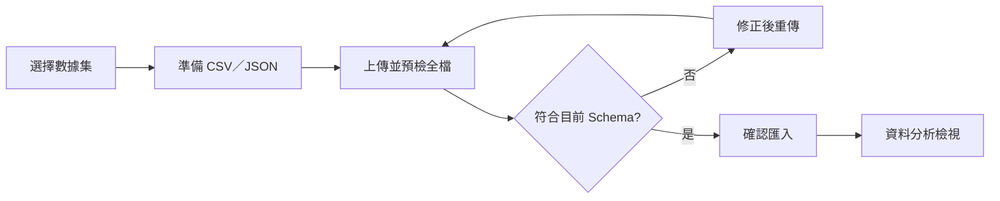

# Streamlit 前端操作手冊

啟動後開啟 [Streamlit](http://localhost:8501)。登入後，Admin 的左側選單依序為「服務概況」、「使用者清單」、「建立數據集」、「建立資料」、「批次匯入」、「資料分析」。User 沒有使用者清單；Viewer 僅可使用服務概況、數據集檢視及資料分析。登出清除前端 Session；JWT 到期需重新登入。

## 建立與管理數據集

1. 開啟「建立數據集」，輸入名稱及選填說明。
2. 在欄位表新增所需欄位，例如 Iris 的 sepal_length、sepal_width、petal_length、petal_width、species。建立前可增刪尚未儲存的欄位。欄名區分大小寫，不可重複。
3. 每個欄位可在「備註」補充欄位名稱的意義（選填，最多 500 字元）；data_type 可選 string、integer、decimal、datetime、boolean，或留為「未指定」。另設定必填、是否允許 null，以及「唯一值 unique」（預設未勾選）。例如 `id` 可設為 integer、必填且 unique。按「建立數據集」後，Schema 存入 MariaDB。
4. 在「管理數據集」選取已建立的數據集，查看現有欄位及備註；只能在下方新增欄位及其設定，不能修改或刪除已建立欄位。新欄位不回填舊資料，必填與 unique 規則只約束後續資料。

每個數據集可定義 1–100 個欄位。Admin 可管理全部，User 只能管理自己建立的數據集，Viewer 只能檢視。所有登入者可讀取共享數據集。

## 手動建立資料

1. 在「建立資料」先選擇有寫入權的數據集，頁面會顯示其目前 Schema 的欄位。
2. 填寫必填欄位；選填欄位可不填，允許 null 的欄位可明確選擇 null。datetime 使用含時區的 ISO 8601，例如 `2026-10-28T10:00:00+08:00`。
3. 按「建立」。後端驗證欄位、型別、必填與 unique 規則，通過後寫入 MariaDB。若 unique 值已存在會回傳 409；若 Schema 在填寫期間更新，也會回傳 409，請重新載入表單。

手動數值輸入可填數字文字，由後端按指定型別解析；未指定型別的手動輸入保存為文字。decimal 最多 38 位有效數字、12 位小數，日期統一保存為 UTC。

## CSV／JSON 批次匯入

1. 在「批次匯入」先選數據集，再選 CSV 或 JSON，然後上傳檔案。CSV 可勾選「排除第一列欄名」（預設勾選）：首列作為欄名，不當作資料；取消勾選時，檔案沒有欄名，每一列都作為資料，欄位依數據集 Schema 順序對應。
2. 上傳檔案後，畫面只預覽前五筆資料（CSV 欄名顯示為表格標題，不計入筆數）。按「預檢檔案」後，後端仍檢查全檔，包含 unique 欄位是否與既有資料或同檔其他列重複；成功時顯示總筆數與最多五筆正規化樣本，此時不寫入資料。
3. 按「確認匯入」。後端再次驗證，以單一交易保存整批資料；任一列錯誤則整批不寫入。成功後至「資料分析」檢視。

檔案上限為 **2 MiB、1000 筆資料**。CSV 使用 UTF-8（可含 BOM）。勾選排除首列時，欄名不可重複、須與 Schema 完全一致，順序不限；取消勾選時，檔案每列欄位數須符合 Schema，順序也須相同。兩種模式都不可有列寬不一致。JSON 頂層須為物件陣列，不接受重複 key 或巢狀值。JSON 指定型別時應使用對應原生型別，例如 integer 使用數字；CSV 文字會依指定型別解析。未指定型別仍只接受字串、有限數字或布林值。切換數據集、Schema、格式、檔案或首列選項後，需重新預檢。同一操作的網路重試使用冪等鍵以避免重複寫入。

unique 以**同一數據集、同一欄位**為範圍；有值時不得重複。若欄位允許省略或 null，這兩種情況可出現多次。資料型別為數值時，`1` 與 `1.00` 視為相同。舊數據集的欄位預設 unique=false，既有欄位不能事後改成 unique。

「建立資料」和「批次匯入」直接列出可寫入的數據集，不顯示數據集清單頁碼。

## 資料分析

頁面依序顯示「選擇數據集」、「資料分析」與「數據檢視」。選擇數據集後，可在「篩選器」選取零個或多個欄位；未指定型別的欄位暫不提供篩選與統計。datetime 需同時指定起始與終止日期、時間，使用 UTC 並包含兩端；integer／decimal 可設定包含邊界的最小值與最大值，預設使用資料中的極值；boolean／string 以勾選框選取一個或多個類別，預設全選。空值／未填可作為分類選項。

「統計分析」先選分析欄位。數值欄位顯示直方圖與箱型圖；箱型圖的鬚線表示最小／最大值，箱體表示第一／第三四分位數，白線表示中位數，紅色菱形表示平均值，圖下方另列最小值、最大值、平均值與中位數的實際數值。分類欄位需再選數值目標欄位，可檢視各類別的數量、比例、平均值或總和；時間欄位需再選數值目標欄位，顯示按 UTC 時間排序的趨勢圖，同一時間的多筆值取平均。篩選作用於整份數據集的統計結果，下方資料表維持完整數據集；資料量大時載入可能較久。

全站浮點數顯示最多保留小數點後 3 位，會依第 4 位四捨五入並省略尾端的 0；統計卡、圖表、數據檢視及匯入預覽使用相同規則。此設定只影響畫面顯示，不會改寫資料庫中的原始值。數值篩選器的預設上下限會向外取整到 3 位，確保原有最小值與最大值仍包含在範圍內。

在「數據檢視」查看表格，並用表格下方的「頁碼」切換資料；數據集選擇器不顯示清單頁碼。每頁固定最多 **10 筆**。點表格欄名會依該欄由小到大排序，再點一次改為由大到小；排序作用於整個數據集，切換排序後從第 1 頁開始。空值排在最後。列表顯示資料 ID、寫入時 Schema 版本與目前數據集欄位；舊資料沒有後來新增的欄位時顯示空白。

滑鼠移到可管理的資料列時會顯示「刪除」按鈕，點擊後直接刪除該列。User 只能刪除自己建立的資料，Admin 可刪除全部，Viewer 不會看到刪除按鈕；後端同樣檢查權限。刪除不可復原，該列的 unique 值會釋放。

含時間欄位的公開範例可參考 [Vega 股票資料集](https://github.com/vega/vega-datasets/blob/main/data/stocks.csv)。原始 `date` 格式例如 `Jan 1 2000`，匯入 datetime 欄位前需轉成含時區的 ISO 8601 格式，例如 `2000-01-01T00:00:00+00:00`。

## 常見情況

| 訊息 | 處理方式 |
| --- | --- |
| HTTP 422 | 檢查欄名、必填、null、data_type 及檔案結構 |
| HTTP 409 | Schema 已更新或冪等鍵對應內容改變，重新載入並預檢 |
| HTTP 401／403 | 重新登入或確認數據集寫入權 |
| HTTP 413 | 將檔案縮小至 2 MiB 以下後分批匯入 |

其他角色與 API 資訊見 [使用者與資料管理](user-and-data-management.md)。

表格互動採用 [Streamlit 自訂元件](https://docs.streamlit.io/develop/concepts/custom-components/components-v1/intro)。
